<div align="center">

# 🧪 TO21 MSDS 검수

`Team README`

**위험하게 잘못 적힌 MSDS를 먼저 찾아 주는 검수 도구**

MSDS(물질안전보건자료) PDF → TO21 스키마 v0.6 JSON → 법 기준 정합성 판정 → 사람이 근거를 보고 확정

### 🔗 [온프레미스 배포 데모 바로가기](https://8mypgoxr0il7mu-8080.proxy.runpod.net/)

<sub>Apache · 앱 · DB · vLLM을 한 대의 GPU 서버에 올린 시연 서버입니다 (Basic 인증, 외부 API 없음)</sub>


</div>

---

## 👥 팀원

<div align="center">

**팀 이름: README** · 프로젝트: **TO21 MSDS 검수**

| <a href="https://github.com/sunub"></a> | <a href="https://github.com/steve0joo"></a> | <a href="https://github.com/azeroo0"></a> | <a href="https://github.com/nnieun"></a> | <a href="https://github.com/HwangSoon96"></a> | <a href="https://github.com/JINI1018"></a> |
|:-:|:-:|:-:|:-:|:-:|:-:|
| **최정민<br>(팀장)** | **주세환** | **윤아영** | **김나경** | **황태순** | **김우진** |
| [@sunub](https://github.com/sunub) | [@steve0joo](https://github.com/steve0joo) | [@azeroo0](https://github.com/azeroo0) | [@nnieun](https://github.com/nnieun) | [@HwangSoon96](https://github.com/HwangSoon96) | [@JINI1018](https://github.com/JINI1018) |
| <sub>전처리·OCR<br>추출<br>프론트엔드</sub> | <sub>추출<br>모델·평가<br>파인튜닝</sub> | <sub>PM<br>프론트엔드<br>정합성 엔진</sub> | <sub>전처리·OCR<br>추출 백엔드<br>문서·데이터</sub> | <sub>온프레미스 배포<br>정합성 백엔드<br>문서·데이터</sub> | <sub>PM<br>정합성 엔진<br>모델·평가<br>파인튜닝</sub> |

</div>

---

## 📑 목차

1. [프로젝트 소개](#-프로젝트-소개)
2. [기업이 겪는 문제와 해결 방법](#-기업이-겪는-문제와-해결-방법)
3. [성과](#-성과)
4. [역할](#-역할)
5. [기술 스택](#-기술-스택)
6. [아키텍처](#-아키텍처)
7. [화면 기능](#-화면-기능)
8. [추출 파트](#-추출-파트): OCR 시행착오 · 모델 시행착오
9. [검증 파트](#-검증-파트): 정합성 검증 로직 · 검증 모델과 평가
10. [나머지 기능](#-나머지-기능)
11. [실행과 배포](#-실행과-배포)
12. [한계와 앞으로](#-한계와-앞으로)
13. [팀 개발 규칙](#-팀-개발-규칙)
14. [더 읽을 문서](#-더-읽을-문서)

---

## 🎯 프로젝트 소개

MSDS PDF에서 16개 항 중 **1·2·3·8·9·11·12·14·15항**을 TO21 스키마 v0.6 JSON으로 뽑고, 2항(유해·위험성)과 15항(국내 법적 규제)을 지식DB와 대조해 판정합니다. 판정 결과는 검수 화면에서 사람이 근거를 보고 확정합니다.

실제 배포는 폐쇄망이 원칙이라 외부 API는 쓰지 않고 로컬 모델로만 돌아갑니다.

> 담당자가 문서를 처음부터 끝까지 읽는 대신, 위험해 보이는 항목부터 근거와 함께 확인하게 하는 것이 목표입니다.

## 💡 기업이 겪는 문제와 해결 방법

MSDS는 화학제품을 거래할 때 반드시 따라붙는 문서입니다. 성분, 유해성, 취급 방법, 법적 규제가 적혀 있어서 **현장 노동자의 안전과 바로 이어집니다.** 이 문서가 틀리면 피해는 서류 문제로 끝나지 않습니다.

| 사례 | 일어난 일 |
|---|---|
| 한화에어로스페이스 대전사업장 특별감독 (고용노동부, 2026) | 473건이 적발됐고, 과태료 284건(5억 510만원) 가운데 **MSDS 위반이 1억 7,900만원(56건)으로 가장 큰 항목**이었습니다 |
| 창원 두성산업 (2022) | 세척제 성분(트리클로로메탄)에 노동자 16명이 급성중독됐고, 대표가 중대재해처벌법 위반으로 입건됐습니다 |

문서 검증을 놓쳤을 때 치르는 비용은 과태료보다 **사람의 몸과 경영책임자의 책임**에 가깝습니다. 그런데 이 검증은 지금도 사람이 문서를 처음부터 읽고 법 기준과 하나씩 대조하는 수작업입니다. 현장에서 막히는 곳은 아래 여섯 가지이고, 문제마다 해결 방법을 하나씩 짝지었습니다.

<p align="center">
  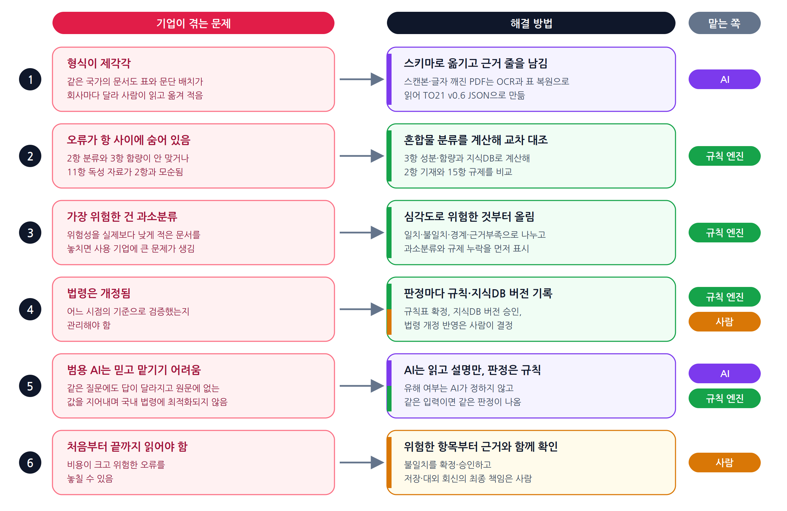
</p>

<details>
<summary>글로 보기</summary>

| | 기업이 겪는 문제 | 해결 방법 | 맡는 쪽 |
|:-:|---|---|:-:|
| 1 | **형식이 제각각입니다.** 같은 국가의 문서라도 표와 문단 배치가 회사마다 달라 사람이 읽고 옮겨 적어야 합니다. | 제각각인 PDF에서 값을 TO21 스키마로 옮기고, 값마다 **근거 줄**을 남깁니다. 스캔본과 글자 깨진 PDF는 OCR과 표 복원으로 읽습니다. | AI |
| 2 | **오류가 항 사이에 숨어 있습니다.** 2항의 분류와 3항의 함량이 안 맞거나, 11항 독성 자료가 2항과 모순됩니다. | 3항의 성분·함량과 지식DB로 **혼합물 분류를 계산**해 2항 기재와 대조하고, 15항 규제 해당 여부도 계산해 비교합니다. | 규칙 엔진 |
| 3 | **가장 위험한 건 과소분류입니다.** 위험성을 실제보다 낮게 적은 문서를 놓치면 사용하는 기업에 큰 문제가 생깁니다. | 결과를 일치·불일치·경계·근거부족으로 나누고, **과소분류와 규제 누락은 심각도를 높게** 줘서 먼저 올립니다. | 규칙 엔진 |
| 4 | **법령은 개정됩니다.** 어느 시점의 기준으로 검증했는지 관리해야 합니다. | 판정마다 **적용한 규칙과 지식DB 버전**을 남깁니다. 규칙표 확정, 지식DB 버전 승인, 법령 개정 반영은 사람이 합니다. | 규칙 엔진 + 사람 |
| 5 | **범용 AI는 믿고 맡기기 어렵습니다.** 같은 질문에도 답이 달라지고 원문에 없는 값을 지어내며, 국내 법령 검증에 최적화되어 있지 않습니다. | AI는 **읽고 설명만** 하고 유해 여부는 정하지 않습니다. 판정은 규칙 엔진이 내서 같은 입력이면 같은 결과가 나옵니다. | AI + 규칙 엔진 |
| 6 | **사람이 문서를 처음부터 끝까지 읽어야 합니다.** 비용이 크고 위험한 오류를 놓칠 수 있습니다. | 담당자는 **위험한 항목부터 근거와 함께** 확인하고 불일치를 확정·승인합니다. 저장과 대외 회신의 최종 책임은 사람에게 있습니다. | 사람 |

</details>

그래서 일을 세 갈래로 나눴습니다. AI는 **읽고 설명하고**, 규칙 엔진은 **판정하고**, 사람은 **확정하고 책임집니다.**

| 구분 | 지금 | 도입 후 |
|---|---|---|
| 검토 시작점 | 문서를 처음부터 읽음 | 불일치·경계·근거부족 항목부터 확인 |
| 값 확인 | 원문에서 직접 찾음 | 근거가 붙은 추출값을 대조 |
| 판정 | 기준 자료와 직접 비교 | 규칙 엔진의 판정과 그 이유를 검토 |
| 우선순위 | 담당자가 직접 정함 | 과소분류·규제 누락을 먼저 봄 |
| 기록 | 확인 필요 | 판정 근거, 기준 버전, 검토 이력이 남음 |
| 최종 결정 | 사람 | 사람 (변하지 않음) |

## 📈 성과

목표는 **TO21 채점기에서 필수 17개 항목 통과와 종합 90점**, 그리고 **규칙 엔진으로 과소분류·누락 95% 이상 검출**입니다. 지금까지 측정한 값은 다음과 같습니다.

| 무엇을 | 전 | 후 | 기준 |
|---|---|---|---|
| 항별 구조로 바꾼 추출 점수 | 66.3 | **90.2** | S014 골드 |
| 개선 누적 점수 | 76.5 | **88.4** | 골드 4건, 커밋 18개 중 점수를 내린 변경 없음 |
| 전처리 품질 | | **97.0** | 현재 코드로 다시 잰 값 |
| 전처리 시간 | 274.33초 | **109.85초** | 20개 문서 241쪽 |
| AI 설명 글의 사실 오류 | 19/30 | **0/30** | 판정 설명 고정 표본 30줄, AI 채점. 오해 소지 10/30은 남음 |
| 교사 라벨에서 원문에 없는 값 | | **0/3,411** | 파인튜닝용 Claude 추출 79건의 숫자·CAS·UN 값 |
| 파인튜닝 (원본 q36 → 학습 후 `ftr_q36`) | 84.2 | **90.5** | 개발 골드 10건, 오류 280 → 129건, 필수 통과 6 → 11/17 |
| 판정 재현성 | | **차이 0** | 실제 지식DB, 790줄, 순차 3회와 동시 8개 |

종합 90점과 필수 17개 항목 통과를 전체 평가셋에서 확인한 결과는 아직 이 문서에 없습니다. 위 점수는 개발용 골드 문서 기준입니다.

## 🧑‍🤝‍🧑 역할

팀 **README**의 역할 분담입니다. 한 사람이 여러 영역을 오갔습니다.

| 영역 | 하는 일 | 주로 한 사람 |
|---|---|---|
| 전처리·OCR | 쪽 이미지, 텍스트층, 표 복원, 품질 점검 | sunub, nnieun |
| 추출 | 항별 프롬프트, 모델 호출, 입력 계약, 항별 실험 | sunub, steve0joo |
| 정합성 엔진 | 규칙표, 혼합물 분류 계산, 15항 규제 판정, 오류 주입 시험 | JINI1018, azeroo0 |
| 추출 백엔드 | 추출 API, 작업 큐와 워커, 추출 결과 저장 | nnieun |
| 정합성 백엔드 | 판정 API, 판정·설명 저장, 지식DB 연결 | HwangSoon96 |
| 프론트엔드 | 업로드, 추출 확인, 검수 화면 | azeroo0, sunub |
| 모델·평가 | 모델 서빙, 채점 | JINI1018, steve0joo |
| 파인튜닝 | 교사 라벨로 학습 데이터 만들기, QLoRA 학습·평가 | JINI1018, steve0joo |
| 온프레미스 배포 | Docker compose, RunPod Pod 구성, 폐쇄망 반입 | HwangSoon96 |
| PM | 일정·범위 관리, 기획, 결정 기록, 팀 조율 | JINI1018, azeroo0 |
| 문서·데이터 | 방법 정리, 작업 기록, 골드·실버 데이터 | HwangSoon96, nnieun |

## 🧰 기술 스택

| 영역 | 사용한 것 |
|---|---|
| **백엔드** | Python 3.11~3.12, uv, FastAPI 0.162, Uvicorn, psycopg 3 + 커넥션 풀, jsonschema(TO21 스키마 검증), PyYAML, openpyxl |
| **PDF·OCR** | PyMuPDF(쪽 이미지·텍스트층), PaddleOCR 3.2 + PaddlePaddle GPU(CUDA 12.9), Docling(표 복원), onnxruntime-gpu |
| **모델 서빙** | vLLM 0.32, Qwen3.6-35B-A3B-FP8, OpenAI 호환 API(`openai` SDK로 호출), RunPod GPU |
| **파인튜닝** | LoRA·QLoRA(`finetune/`) |
| **정답 초안(개발 전용)** | GPT, Claude로 만든 실버 JSON을 사람이 검수해 골드로 확정. 폐쇄망에는 들어가지 않습니다 |
| **프론트엔드** | Next.js 16, React 19, TypeScript 5.9, Tailwind CSS 4, TanStack Query, React Hook Form + Zod, pdf.js, pnpm, Node 24 |
| **DB** | PostgreSQL 16 (지식DB `kdb`, 서비스 `msds_service`), TO21 HTODB(SQL Server mdf)를 PostgreSQL로 적재 |
| **배포** | Docker Compose, Apache httpd 2.4, RunPod Pod(venv + 프로세스) |
| **시험** | pytest(백엔드), `node --test`(프론트엔드), Makefile |

## 🏗 아키텍처

### 전체 흐름

PDF를 올리면 전처리, 항별 추출, 정합성 검증, 사람 검수를 거쳐 DB에 저장됩니다. 색은 누가 하는 일인지를 뜻합니다(보라는 AI, 초록은 규칙 엔진, 주황은 사람, 회색은 시스템).

<p align="center">
  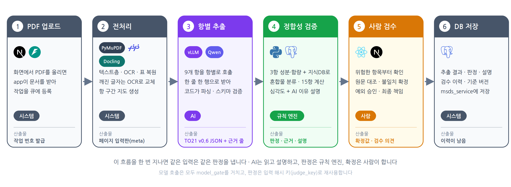
</p>

AI는 읽고 설명만 하고, 판정은 규칙 엔진이 내고, 확정은 사람이 합니다. 모델이 판정에 관여하지 않는다는 점이 이 구조의 핵심입니다.

### 시퀀스 다이어그램

누가 누구에게 무엇을 요청하는지를 시간 순서로 그렸습니다. 오래 걸리는 추출은 DB 작업 큐에 올려 두고 worker가 처리하며, 화면은 진행 상황을 조회합니다.

<p align="center">
  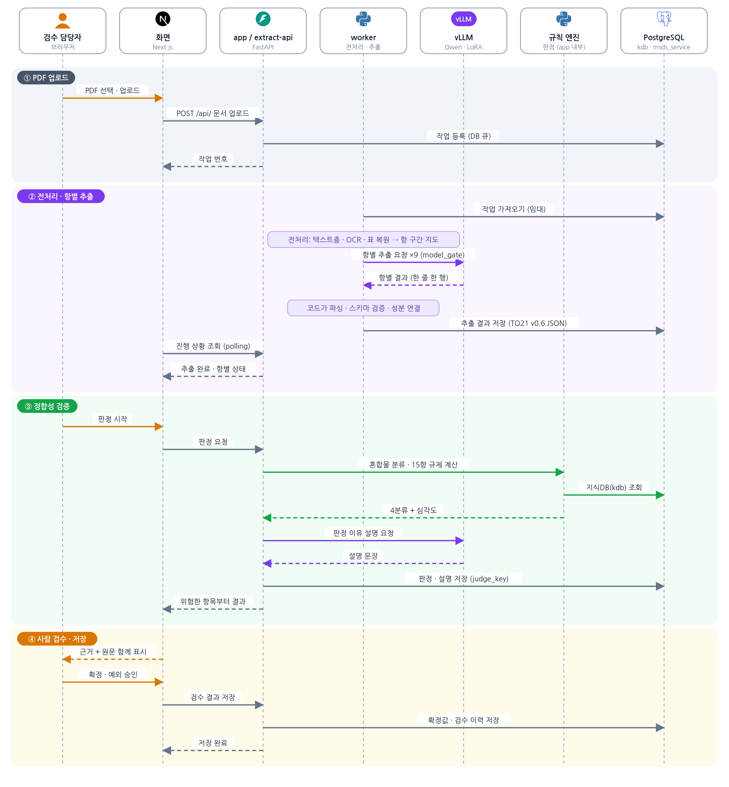
</p>

### 시스템 구성과 기술 스택

계층별로 어떤 기술을 쓰는지 한 장에 모았습니다. `deploy/compose/compose.yaml` 기준이고, 바깥에 열리는 포트는 `web` 하나뿐입니다.

<p align="center">
  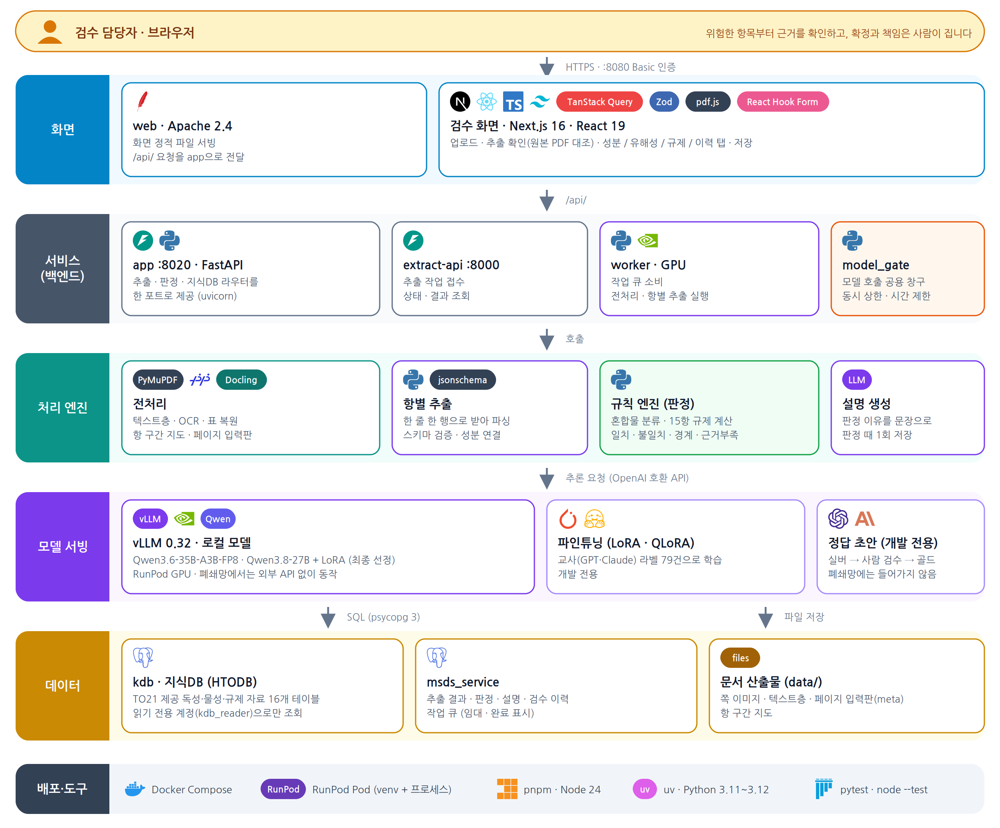
</p>

- 요청은 web, app, extract-api 순으로 내려가고, 오래 걸리는 추출은 DB 작업 큐를 거쳐 worker가 처리합니다.
- 모델 호출은 전부 `model_gate`를 지납니다. 동시 상한과 타임아웃을 한곳에서 관리하기 위해서입니다.
- Docker를 못 쓰는 RunPod Pod에서는 compose 대신 `deploy/runpod/app/` 방식으로 같은 구성을 venv와 프로세스로 한 Pod 안에 올립니다(포트만 vLLM 8000, 글자추출 API 8001, PostgreSQL 5433으로 다릅니다).
- 그림 원본은 [docs/images/](docs/images)의 SVG입니다.

### 코드 구조

<details>
<summary>폴더별 역할 보기</summary>

| 폴더 | 하는 일 |
|---|---|
| [backend/src/msds/preprocess](backend/src/msds/preprocess) | PDF를 쪽 이미지, 텍스트층, OCR, 표 복원으로 바꿉니다 |
| [backend/src/msds/extract](backend/src/msds/extract) | 항별 프롬프트와 모델 호출, 실행기 |
| [backend/src/msds/checks](backend/src/msds/checks) | 형식 검사, 원문 대조 |
| [backend/src/msds/compliance](backend/src/msds/compliance) | 2항·15항 규칙 엔진과 규칙표 |
| [backend/src/msds/judge](backend/src/msds/judge) | 판정 실행, 설명 생성, 리포트 |
| [backend/src/msds/service](backend/src/msds/service) | 작업 큐, 워커, 입력 계약, 결과 저장 |
| [backend/src/msds/api](backend/src/msds/api) | FastAPI |
| [backend/src/msds/review](backend/src/msds/review), [evaluate](backend/src/msds/evaluate) | 검수표 만들기와 채점. 개발할 때만 쓰고 폐쇄망에는 들어가지 않습니다 |
| [backend/migrations](backend/migrations) | DB 스키마 SQL |
| [frontend](frontend) | 검수 화면(Next.js) |
| [finetune](finetune) | 추출 모델 QLoRA 파인튜닝 |
| [deploy](deploy) | Docker compose, RunPod, DB 설정 |
| [docs](docs) | 설계 문서, 작업 기록, ADR, 방법 정리 |

</details>

`to21/`에는 TO21이 준 스키마와 명세서, 채점기가 들어가는데 외부 공유 금지 자료라 저장소에는 올리지 않습니다. 런타임 코드가 `review/`나 `evaluate/`를 불러오지 않는지는 `backend/tests/test_boundary.py`가 검사합니다.

## 🖥 화면 기능

Next.js 16으로 만든 정적 화면이고, 빌드 결과를 Apache가 서빙합니다. 화면은 **1 추출 → 2 검수 → 3 저장** 세 단계로 이어지며, 위쪽 단계 탭으로 오갑니다. 아래 스크린샷은 실제 화면을 띄워 찍은 것이고, 문서 이름과 값은 모두 **가상 데이터**입니다(TO21 자료는 쓰지 않았습니다).

### 1. 홈: 문서 올리기와 목록

PDF를 끌어 놓거나 파일을 골라 올리면 추출이 시작됩니다(한 번에 한 건, 50MB까지). 기준일(이 날짜의 법령과 기준으로 판정)과 검토자 이름을 정해 두면 수정 기록과 결과 PDF에 이름이 남습니다. 아래 목록에서는 이전에 작업한 문서의 **단계, 진행(`9 / 9항`), 파일 종류**(일반 PDF, 글자가 깨진 PDF 등), 마지막 작업 시각을 보고 이어서 검수할 수 있습니다. 진행 중·완료·실패로 걸러 볼 수 있고, 실패한 문서는 다시 돌릴 수 있습니다.

<p align="center">
  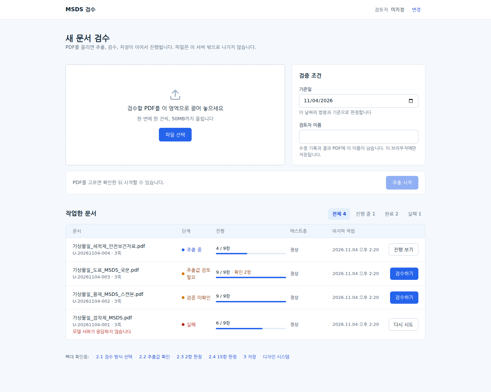
</p>

### 2. 추출 확인: 항별 진행 상황

왼쪽에서 원본 PDF를 보고(쪽 이동, 확대, 쪽 맞춤), 오른쪽에서 9개 항이 어디까지 추출됐는지 봅니다. 항을 누르면 원문이 그 쪽으로 넘어가고, 끝난 항은 추출값을 볼 수 있습니다. 화면을 닫아도 추출은 계속되며, 검수는 추출이 끝나야 열립니다.

<p align="center">
  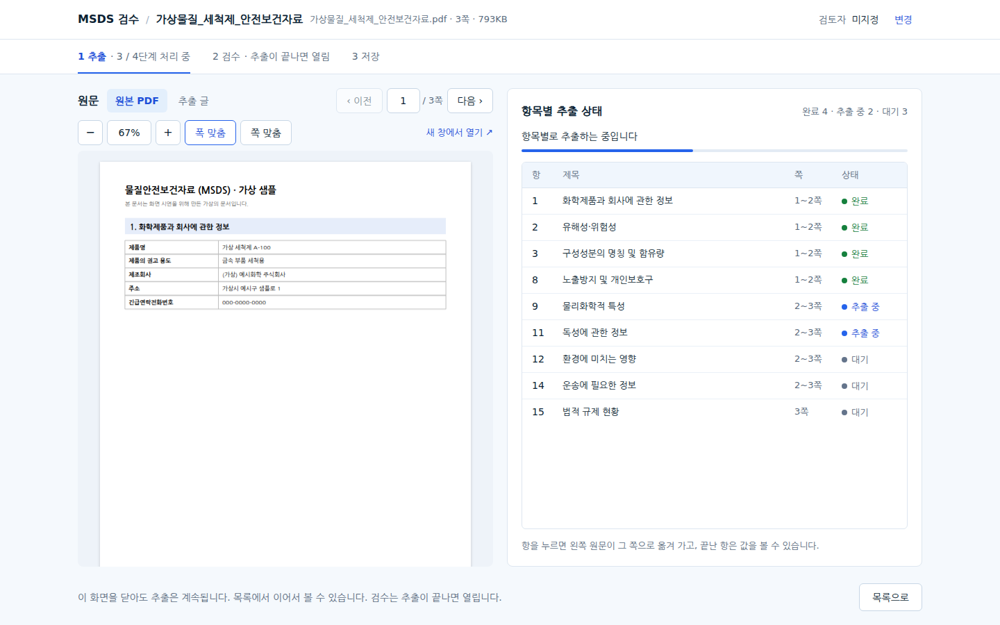
</p>

### 3. 방식 선택: 추출값 확인부터 할까, 판정으로 바로 갈까

추출이 끝나면 **추출값 검증 결과**를 먼저 요약해서 보여 줍니다(스키마 오류, TO21 검사 오류·경고, 추출 실패 항 수). 입력 유형(디지털 PDF인지 스캔본인지)과 추출 상태에 따라 어떤 길이 좋은지 권장도 알려 줍니다.

- **추출값 확인부터 하기(권장)**: 다시 만든 MSDS를 원문과 나란히 놓고 칸마다 확인하고 고칩니다. 확인한 칸은 "확인함", 고친 칸은 "수정됨"으로 기록됩니다.
- **판정으로 바로 가기**: 추출값 확인을 건너뛰고 2항·15항 판정부터 봅니다. 건너뛴 추출값은 "미검수"로 남고 나중에 언제든 확인할 수 있습니다.

글자를 파일에서 바로 읽은 디지털 PDF는 신뢰도가 높아 건너뛸 수 있고, 스캔본은 추출값 확인을 권장하는 식으로 문서 종류에 따라 안내가 달라집니다.

<p align="center">
  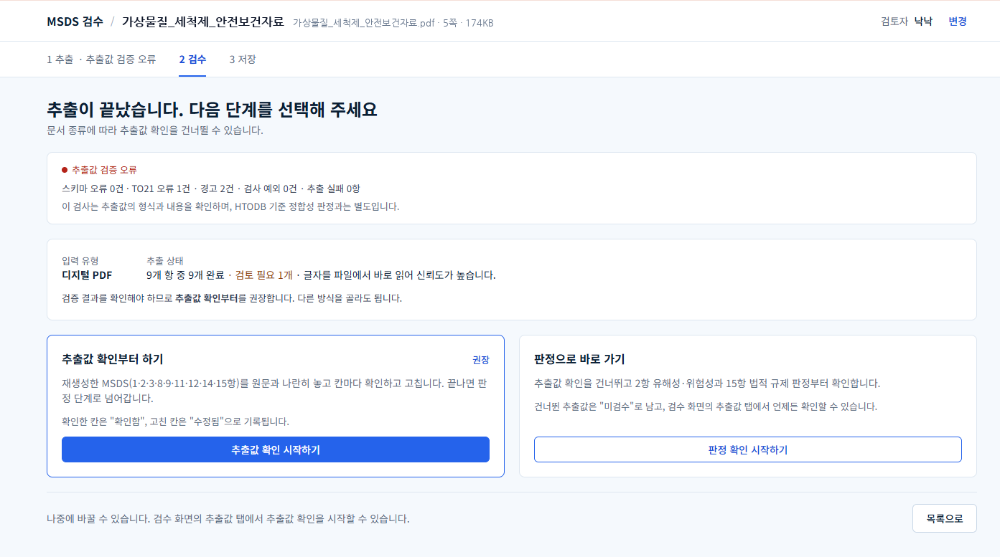
</p>

### 4. 검수: 위험한 항목부터 확인하고 확정

탭은 **2항 유해성·위험성 / 15항 법적 규제 / 성분별 요약 / 검토 이력 / 추출값** 다섯 개입니다. 판정 표는 심각도가 높은 항목(과소분류, 규제 누락)을 먼저 보여 주고, 불일치·경계·근거부족·일치·미처리로 걸러 볼 수 있습니다. 표에서 행을 고르면 아래에 **해당 쪽의 원본 PDF**와 상세가 같이 나옵니다.

- 상세에는 MSDS 기재와 검증 결과(예: MSDS 기재 없음 → 계산 결과 분류안됨, 독성 자료가 모자라면 판정은 근거부족), AI가 쓴 설명(검사 ✓ 표시), 판단 근거와 계산 과정이 있습니다.
- 담당자는 의견을 적고 **불일치 확정 / 예외 승인 / 이전·다음 미처리** 중 하나를 고릅니다. 예외 승인은 의견이 필수입니다.
- 일치한 항목과 범위 밖·비교 제외 항목은 접어서 따로 두어, 판단이 필요한 줄만 먼저 보입니다.
- 리포트는 HTML과 Excel로 내려받을 수 있습니다.

<p align="center">
  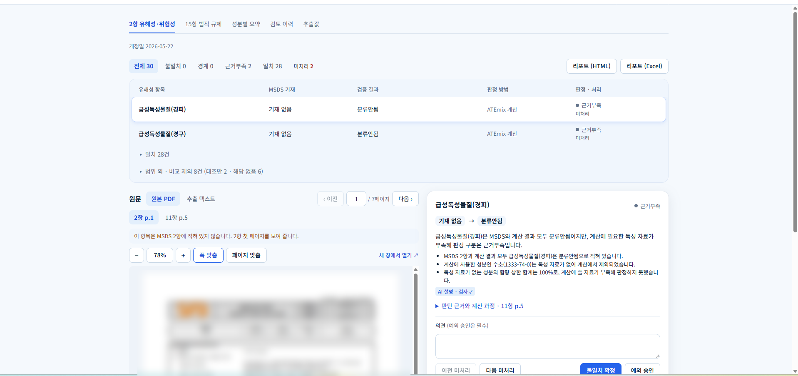
</p>

15항은 법령(산안법, 화관법, 화평법, 위험물법)별로 나눠 보고, 규제 DB 결과와 MSDS 기재를 나란히 비교합니다. "처리 필요만" 체크로 남은 일만 걸러 볼 수 있습니다.

<p align="center">
  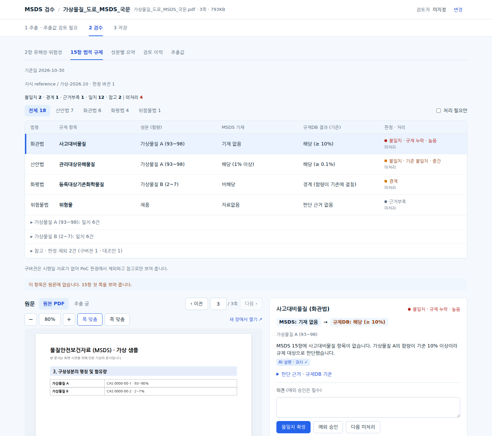
</p>

성분별 요약은 3항의 성분마다 기준 분류와 급성 독성 값을 어떤 근거(독성DB 수치, 분류 환산값, MSDS 11항 수치 등)로 정했는지 1~6단계 순서로 보여 주고, 신뢰도를 함께 표시합니다. 어떤 값이 왜 쓰이지 않았는지(예: 형태별 값이 없어 계산에 쓰이지 않음)도 아래에 적어 둡니다.

<p align="center">
  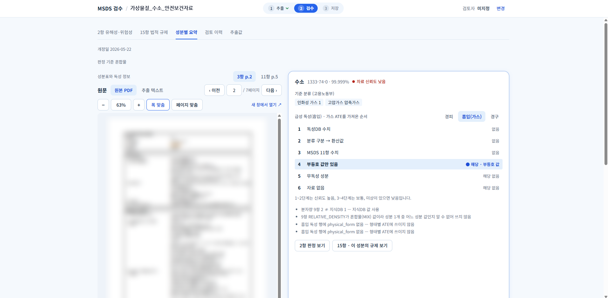
</p>

검토 이력에는 아직 처리하지 않은 판정과 지금까지 누가 무엇을 확정·승인·수정했는지가 시각 순서로 남습니다. 저장한 이력(저장본 번호, 판정 버전)도 함께 남습니다. 확인하지 않은 추출값은 저장 결과에 "미검수"로 남습니다.

<p align="center">
  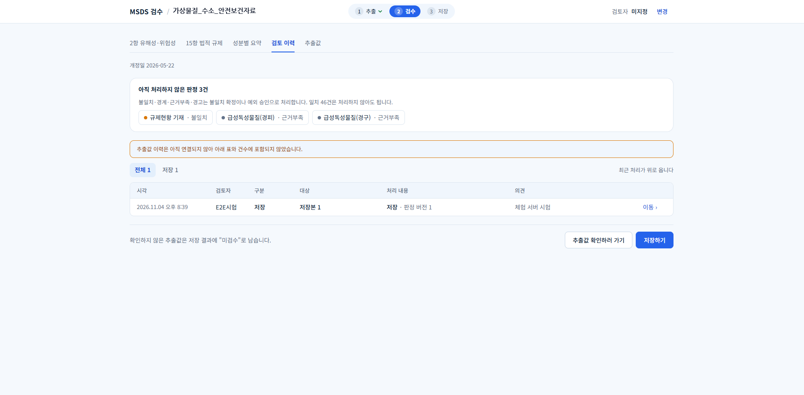
</p>

**추출값** 탭에서는 재생성 MSDS를 항 단위로 펼쳐 칸마다 **확인함 / 고치기**를 누릅니다. 값 옆의 "원문 1페이지"를 누르면 왼쪽 원본 PDF가 그 쪽으로 넘어갑니다. 검토자 이름을 입력해야 확인·수정할 수 있고, 아래에는 "9항 중 몇 항을 확인했는지"가 표시됩니다. 확인하지 않은 항은 저장할 때 "미검수"로 남습니다.

<p align="center">
  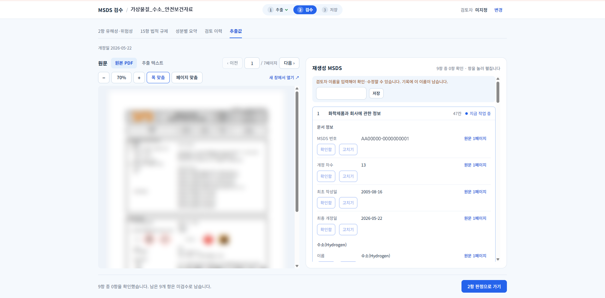
</p>

### 5. 저장: DB에 저장하고 PDF로 내보내기

검수가 끝나면 결과를 DB에 저장합니다. 처리하지 않은 판정이 남아 있어도 저장할 수 있지만, 그 판정은 그대로 **"미검토"로 기록**되고 PDF에도 같은 표시가 붙습니다.

- **2차 판정 요약**: 불일치·경계·근거부족·경고·일치 건수와 처리 상태(미검토, 처리)를 한눈에 보여 주고, 남은 판정을 처리하러 바로 갈 수 있습니다.
- **데이터베이스에 저장**: 저장 시각, 저장한 사람, 몇 번째 저장본인지, 저장 내용(최종 값, 값의 출처, 2차 판정, 처리 상태, 의견)을 보여 줍니다. 값의 출처는 **확인함 / 수정됨 / 미검수(확인하지 않음)** 칸 수로 나뉩니다. 수정한 칸은 고친 값으로 저장되고, 고치기 전 값은 추출 원본에 남습니다. 다시 저장하면 새 번호로 쌓이고 이전 저장본은 그대로 남습니다. JSON으로 내려받을 수도 있습니다.
- **PDF로 출력**: 표지(문서 번호, 제품명, 원본 파일, 기준일, 판정 개수와 미검토 건수), 재생성 MSDS(최종 값으로 만든 16항 문서), 2항·15항 판정 표(처리 상태와 검토자 의견), 성분별 요약, 부록(누가 언제 무엇을 처리했는지)을 골라 담고 미리 볼 수 있습니다. 원문 PDF는 들어가지 않습니다.

<p align="center">
  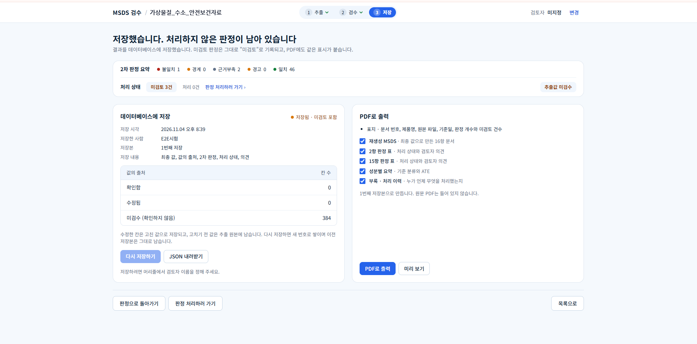
</p>

저장 전에 확인 대화상자가 한 번 더 뜨고, 판정을 아직 시작할 수 없는 상태(추출 안 됨, 실패, 연결 안 됨 등)에는 상태별 안내를 보여 줍니다.

검수자 이름(화면 오른쪽 위), PDF 뷰어(pdf.js), 값 패널은 모든 화면에서 공통으로 쓰입니다. 화면과 API 연결 현황은 [docs/2026-11-02_프론트엔드_API_연결_현황.md](docs/2026-11-02_프론트엔드_API_연결_현황.md)에 있습니다.

## 📄 추출 파트

PDF에서 값을 읽어 오는 쪽입니다. 문서를 잘못 읽으면 값이 틀리고, 판정이 틀리고, 위험한 문서를 놓치기 때문에 가장 먼저 공을 들였습니다. 현실의 PDF는 스캔 이미지이거나, 텍스트층이 있어도 글자가 깨져서 렌더링되는 경우가 있었습니다.

### OCR 시행착오

선으로 그린 표, 선 없는 표, 글자가 겹쳐 찍힌 텍스트층, 그림으로 들어간 표는 문제의 원인이 제각각이었습니다. 한 가지 방법으로 모든 표를 풀려던 게 문제였고, **13개 버전을 거치면서 원인별로 나눠** 풀었습니다. 성분표와 규제표는 행 하나가 곧 판정 한 줄이라, 행이 밀리면 성분과 함량이 어긋난 채로 판정이 나가기 때문입니다.

| 부딪힌 문제 | 예 | 해결 |
|---|---|---|
| 줄 간격과 행 간격이 같은 표 | M005 2쪽 | 줄이 아니라 **글자 좌표로 재조립**하고, 같은 자리의 중복 글자는 하나만 남김. 읽기 순서는 recursive XY-cut으로 복원 |
| 글자·띄어쓰기·문장부호가 다른 레이어로 겹쳐 찍힘 | M013 ("점막과눈그리고경피로…") | 텍스트층과 OCR의 **어절 일치율(F1)이 0.75 미만이면 OCR 글**로 교체. 정상 페이지 최소 0.784, M013 최대 0.679 사이에 기준을 둠 |
| 테두리 없는 표를 Docling이 표로 인식 못 함 | T21-002 4항 (version11) | Docling을 모든 표에 쓰던 version12(75개 중 68개 교체)를, **선표를 먼저 읽고 못 찾은 표에만** 쓰는 version13(75개 중 11개 교체)으로 변경 |
| 표가 그림으로만 들어감 | 039번 1쪽, S013 15항 | 텍스트층에 내용이 없어 OCR과 쪽 이미지로 읽음 |
| 칸 값이 다음 줄로 넘어감, 좁은 열 라벨이 잘못 붙음 | `LD50` 아래 `경피`, `흡입` | 넘어간 값은 그 칸에 이어 붙이되 **좁은 열(라벨)은 잇지 않게** 함 |
| 표를 JSON으로 받으면 열이 어긋남 | 열 11개, 기대 8개 | 모델에는 **한 줄 한 행**으로 받고, 열 수가 다르면 해당 항을 한 번 다시 추출. 반복 행은 제거(한 문서에서 280행 반복) |

20개 문서 241쪽 처리 시간이 274.33초에서 109.85초로 줄었습니다(쪽당 1.138초 → 0.456초). 텍스트층이 정상인 쪽에서 OCR을 돌리지 않게 한 효과입니다. Docling이 실제로 개입한 PDF는 7개였고, 나머지 13개는 선표 처리가 이미 정확했습니다. 현재 코드로 다시 잰 전처리 품질은 97.0점입니다.

자세한 과정: [docs/2026-10-30_version1-12_전체_방법정리.md](docs/2026-10-30_version1-12_전체_방법정리.md), [version13](docs/2026-10-30_version13_방법정리.md), [version15](docs/2026-10-31_version15_방법정리.md), [version16](docs/2026-10-31_version16_표구조_보완보고서.md)

### 모델 시행착오

**① 문서 전체를 한 번에 맡기던 구조를 항별로 바꿨습니다.**
완성 JSON을 통째로 쓰게 하니 출력이 8,192토큰에서 잘렸고(로컬 파일럿에서 출력의 34%가 들여쓰기 공백), 항 경계를 못 찾으면 문서 전체가 모든 항 호출에 들어갔습니다. 성분이 하나인 문서에서는 11·12·15항 행이 모두 `MIX`로 붙어 3항 성분과 짝이 안 맞았습니다.

원인은 입력을 하나로 못 박는 기준이 없었고, 성분과 행을 잇는 일을 모델 응답에 맡긴 것이었습니다. 그래서 **모델은 읽기만 하고, 확정할 수 있는 건 코드가** 하도록 바꿨습니다.

- 하나의 페이지 입력판(meta)과 검증된 항 구간 지도만 모델 입력의 기준으로 두고, 서로 모순되면 자동 대체 대신 실행을 멈춥니다 (관례적인 `pNNN.txt`를 실행 중에 몰래 읽던 fallback도 없앴습니다).
- 표가 많은 3·8·9·11·12·14·15항은 한 줄 한 행으로 받아 로컬에서 파싱하고 항별 스키마로 다시 검증합니다.
- 추출 대상을 9개 항으로 줄이고 나머지 항은 모델 호출 없이 원문을 보존합니다.
- 성분 연결, 상태값(`자료없음`·`해당없음`), 비어 있는 법령 코드는 코드가 채웁니다. 두 글자 이하 성분 이름은 앞뒤에 글자가 없을 때만 근거 줄에서 찾게 했습니다(성분 `물`이 `유독물질`, `물벼룩` 줄에 붙던 버그).

결과: S014 골드 66.3 → 90.2.

**② 환각은 모델에게 쓰게 하지 않는 쪽으로 줄였습니다.**
원문에 없는 NFPA 등급을 지어내고, 명세서의 예시 제출번호와 없는 날짜를 값으로 쓰고, 프롬프트의 저장 예를 숫자 칸에 그대로 베끼고, 설명의 근거에 없는 "MSDS N쪽"을 붙였습니다. 예시가 값이 된 게 원인이었습니다.

- 안내문에서 저장 예를 빼고 원문 예만 두었고, 제출번호와 날짜는 원문에 있을 때만 남겼습니다. 이 규칙이 개발 문서 정답 값 30개를 지우지 않는지 먼저 확인했습니다.
- 근거 줄 번호를 필수로 받고 줄 번호 검사를 두었습니다. 근거와 서술 문장은 모델이 아니라 코드가 만듭니다.
- 2항 그림문자는 쪽 이미지에서 읽어 후처리에서 H코드와 대조합니다. 이미지 없이 그림문자 정답을 배우면 지어내므로 학습 데이터에서도 해당 칸을 뺐습니다.
- 입력 방식도 비교했습니다. 쪽 이미지만 넣을 때와 이미지에 텍스트를 함께 넣을 때를 비교하니 316칸 중 20칸이 달랐고, 글자를 넣으면 분류 코드와 번호를 잘못 읽는 일이 줄었습니다. 다만 NFPA는 두 조건 모두 지어냈습니다.

**③ 같은 입력에도 같은 답이 나오지 않았습니다.**
temperature 0에 seed를 고정해도 Ollama MLX는 한 번에 하나씩 보내도 매번 달랐고, llama.cpp는 슬롯 4개로 동시에 보내면 9개 항 중 5개가 바뀌었고, vLLM(FP8)도 순서대로 돌려도 흔들렸습니다. vLLM의 결정적 모드(`VLLM_BATCH_INVARIANT=1`)는 이 모델의 Gated DeltaNet 층을 지원하지 않아 시작에 실패했습니다. 서버 쪽 원인은 끝내 확인하지 못했습니다.

그래서 **출력이 같다는 전제를 버렸습니다.** 판정은 규칙 엔진이 하고 AI는 설명만 하게 나눴고, 입력 해시로 만든 `judge_key`로 같은 입력의 기존 판정을 재사용하고, 설명은 판정 때 한 번 만들어 저장해 둡니다.

**④ 속도를 올리려고 병렬로 보내니 결과가 달라졌습니다.**
설명 LLM을 동시 8개로 보내면 전체 시간이 205초에서 53초(약 3.9배)로 줄었지만, 사실(숫자·코드·구분)이 달라진 줄이 0에서 12/122(9.8%)로 늘었습니다. llama.cpp 슬롯 4개는 1.2~1.3배만 빨라졌고 출력은 Ollama보다 2.5~6배 느렸습니다. **처리 시간보다 결과 일관성을 우선한다**는 팀 결정을 따랐고, 서버의 공백 금지 설정을 켠 조건이 끈 조건보다 골드가 2~3점 높았습니다(같은 조건 두 번의 차이는 약 1점).

**⑤ 파인튜닝.** GPT·Claude(교사)가 새 MSDS 79건을 추출한 결과를, 우리 오픈소스 모델(학생)이 같은 프롬프트로 따라 쓰도록 LoRA·QLoRA로 학습했습니다. 학습이 끝나면 설정 파일의 모델 이름만 바꿔 같은 파이프라인에 씁니다. 개발·평가 문서는 학습에서 자동으로 빠집니다. 자세한 내용은 [finetune/README.md](finetune/README.md)에 있습니다.

개발 골드 10건으로 비교한 최종 결과입니다. `ft`는 LoRA로 학습한 모델, `ftr`는 거기에 2항(그림문자·신호어)만 원본 모델로 부르는 조합이고, `q36`은 Qwen3.6, `q38`은 Qwen3.8입니다.

| 모델 | 가중 종합 | 필수 통과 | 오류 합계 | T21-M004 뺀 9건 | 문서당 시간 |
|---|---:|---:|---:|---:|---:|
| `ftr_q36` (규칙상 선택) | 90.5 | **11/17** | 129 | 90.3 | **25.9초** |
| **`ft_q38` (최고 점수, 최종 선정)** | **91.2** | 9/17 | 112 | 91.4 | 60.6초 |
| `ftr_q38` | 90.7 | 9/17 | 109 | 90.9 | 70.2초 |
| 원본 q38 | 90.1 | 8/17 | 110 | 90.0 | |
| `ft_q36` 둘째 실행 | 89.6 | 10/17 | 168 | 89.5 | 33.2초 |
| 원본 q36 | 84.2 | 6/17 | 280 | 87.3 | |
| 교사 Opus 5.5 (상한 참고) | 92.7 | 11/17 | 81 | | |

- **파인튜닝의 효과는 분명합니다.** 원본 q36은 84.2점에 오류 280건이었는데, 학습 후에는 90점 안팎에 오류 112~168건이 됐습니다. 교사(92.7)에 가까워졌고, 출력이 끝없이 반복되며 잘리던 문제와 재추출도 크게 줄었습니다.
- **모델 선택은 팀이 정했습니다.** 미리 정한 규칙(점수 차이가 2점 미만이면 필수 통과 수로 선택)을 따르면 `ftr_q36`이었습니다. 하지만 두 모델의 차이 0.7점은 같은 설정을 두 번 돌렸을 때의 흔들림(약 0.8점)보다 작아서, 이번 측정만으로는 어느 쪽이 낫다고 단정할 수 없습니다. 최고 점수인 **`ft_q38`(Qwen3.8-27B bf16 + LoRA 1에폭, 2항 분기 없음)을 최종 모델로 고정**했고, 평가 문서를 돌리기 전에 개발셋 결과로 정했습니다.
- **속도는 q36 계열이 2배 이상 빠릅니다.** 문서당 25.9초 대 60.6초입니다. 점수·필수 통과·속도가 모두 엇갈리는 트레이드오프라서 결정 근거를 기록으로 남겼습니다([B-46](docs/backend/b/decisions.md)).
- **2항은 학습하지 않은 항이라 원본으로 부르는 쪽이 낫습니다.** 122B 모델 실험에서 LoRA를 붙인 채로 부르면 신호어와 그림문자 점수가 내려갔습니다(평가 10건에서 신호어 50.8 → 42.9, 그림문자 92.9 → 86.1).
- **8항 노출기준과 12항 생태는 오히려 내려갔습니다.** 교사 답의 작성 방식이 골드와 달라서로 보고, 다음 학습 전에 교사 데이터의 8·12항을 골드 규칙에 맞춰야 합니다.
- **골드 29개로 이어서 한 2단계 학습은 폐기했습니다.** 검증 손실은 내려갔지만 추출 점수는 오히려 0.9점 낮아졌습니다.
- 학습 중 **vLLM에서 LoRA가 조용히 안 붙는 문제**도 찾아 고쳤습니다. 어댑터 이름 규칙이 달라서 오류 없이 원본처럼 답하던 것을 `adapter_for_vllm.py`로 맞췄습니다.

## ✅ 검증 파트

### 정합성 검증 로직

추출한 JSON에서 **2항(유해·위험성)과 15항(국내 법적 규제)이 3항의 성분·함량과 맞는지** 규칙 엔진이 계산합니다. 모델은 쓰지 않습니다.

1. **혼합물 분류 계산**: 3항의 성분과 함량을 지식DB(HTODB)의 독성·물성 자료와 규칙표에 대어 혼합물의 기대 분류를 계산하고, 분류 결과에서 그림문자·신호어·H코드를 도출해 문서에 적힌 값과 비교합니다.
2. **15항 규제 계산**: 함량과 규제 기준으로 기대 해당 여부를 정해 15항 기재와 비교합니다.
3. **결과 분류**: 일치, 불일치, 경계, 근거부족 네 가지로 나눕니다.
4. **심각도**: 위험을 실제보다 낮게 적은 과소분류와 규제 누락을 가장 높게 둬서 먼저 올립니다.
5. **근거 기록**: 판정마다 적용한 규칙, 원문 쪽, 지식DB 버전을 남깁니다. 같은 입력이면 같은 판정이 나옵니다.

판정이 끝나면 LLM이 이유를 문장으로 설명합니다. 이때 설명의 근거(적용 규칙, 원문 쪽, 지식 버전)는 모델이 아니라 엔진이 요청에 있던 값만 옮겨 붙이므로 없는 쪽 번호가 생길 수 없습니다. 글 없는 요약(`:` 한 글자 등)이 나오면 다시 묻고, 그래도 같으면 문장틀로 대체합니다.

규칙표를 확정하는 일, 아직 정해지지 않은 가정을 결정하는 일, 법령 개정을 반영하는 일, 지식DB 버전을 승인하는 일은 사람의 몫입니다. 가정 목록은 [docs/2026-11-02_F_규칙표_가정목록.md](docs/2026-11-02_F_규칙표_가정목록.md), 결정 배경은 ADR([0003](docs/adr/0003-단일물질-판정은-지식DB-없이-약속만-가정해-만든다.md), [0004](docs/adr/0004-15항-판정은-함량과-규제-기준으로-기대-해당-여부를-정한다.md))에 있습니다.

### 검증 모델과 평가

- **채점**: TO21 채점기를 감싸서 씁니다. 골드(사람이 확정한 정답)와 실버(상용 모델이 만든 정답 초안)는 섞지 않고, 사람이 검수하지 못한 칸은 정확도처럼 보고하지 않고 '미검수'로 따로 표시합니다.
- **평가용 문서 보호**: 평가용 문서로 프롬프트를 고치면 점수가 부풀려지므로 실행 전 잠금 검사로 막습니다(`--allow-eval` 없으면 거부). T21-025는 평가 평균에서 뺐습니다([ADR-0005](docs/adr/0005-25번은-평가-평균에서-빼고-따로-쓴다.md)).
- **개선 효과 측정**: 모델을 다시 부르지 않고 저장된 응답을 커밋마다 새 코드로 다시 펼쳐 점수 변화만 비교했습니다. 모델 입력이 바뀌는 커밋은 다시 펼칠 수 없어 '실행 필요'로 따로 표시합니다. 같은 조건으로 두 번 돌려도 응답이 글자까지 같은 항이 160개 중 19~23개뿐이라, 실행 조건은 8회씩 돌려 비교했습니다.
- **교사 라벨 검증**: 파인튜닝에 쓸 Claude 추출 79건에서 숫자·CAS·UN 3,411개 중 원문에 없는 값은 0개였습니다. 다만 값이 원문에 있는지 보는 검사라 올바른 칸에 들어갔는지까지는 보장하지 않습니다. 맥락 없는 검증자가 일부러 틀리게 바꾼 9행 중 7행을 잡았습니다.
- **오류 주입**: 일부러 틀린 문서를 넣어 규칙 엔진이 잡는지 확인했습니다. 결과는 [docs/2026-11-02_F_오류주입_결과.md](docs/2026-11-02_F_오류주입_결과.md)에 있습니다.
- **판정 재현성**: 실제 지식DB와 실버 27건, 790줄을 순차 3회와 동시 8개로 보냈을 때 다른 줄 0, 예외 0이었습니다. 반면 설명(LLM)은 순차 3회는 122줄이 모두 같았지만 동시 8개에서는 19줄(15.6%)만 문장이 완전히 같았습니다. 이 때문에 설명은 한 번 만들어 저장합니다.

## 🗄 나머지 기능

- **지식DB(HTODB) 적재와 조회 API**: TO21이 준 HTODB(SQL Server mdf, 16개 테이블)를 값을 바꾸지 않고 로컬 PostgreSQL로 옮기고, 읽기 전용 계정(`kdb_reader`)으로 조회 API를 엽니다. 테이블마다 원본과 행 수·값 해시가 같아야 커밋합니다. → [deploy/htodb/README.md](deploy/htodb/README.md), [ERD와 API](deploy/htodb/ERD.md)
- **작업 큐와 워커**: 추출 요청을 DB 큐에 쌓고 worker가 가져가 처리합니다. 작업별 잠금 안에서 최신 결정과 완료 표시를 한 트랜잭션에 묶고, 임대 시간(25분)과 `taken_at` 조건으로 늦게 끝난 옛 작업이 최신 판정을 덮지 못하게 막습니다.
- **결과·검토 이력 저장**: 추출 결과, 판정, 설명, 검수 이력을 `msds_service` DB에 저장합니다. 스키마는 [backend/migrations/](backend/migrations)에 있습니다.
- **모델 호출 공용 창구(`model_gate`)**: 동시 상한과 시간 제한을 한곳에서 관리합니다. 서버가 5번 연달아 응답하지 않으면 남은 호출을 보내지 않고 실패로 남기고, SDK 자체 재시도는 껐습니다.
- **문서 동시 처리 수 실험**: 임의로 정하지 않고 단독 두 번과 다른 문서 1·2·4건을 함께 낸 실행의 항목별 점수를 비교해 정합니다([ADR-0006](docs/adr/0006-a1-동시-추출-실험.md)).
- **팀 전달용 HTML 문서**: 백엔드 PRD, API 설계서, ERD 등을 HTML로 만들어 [docs/](docs)에 두었습니다.

## 🚀 실행과 배포

Python 3.11~3.12, [uv](https://docs.astral.sh/uv/), Node 24와 pnpm이 필요합니다.

```bash
git clone git@github.com:sunub/to21-msds-poc.git
cd to21-msds-poc
make setup
cp .env.example .env
```

원본 PDF는 `data/raw/`에, TO21 자료는 `to21/`에 직접 넣어 주세요. `.env`의 API 키는 개발용 정답 초안(실버)을 만들 때만 필요합니다.

```bash
make dev                  # API와 화면을 같이 실행 (DB 필요: deploy/htodb/.env)
make dev-backend-lite     # 추출 API만 실행. DB 없이 파일로 저장합니다
make dev-frontend         # 화면만 실행 (http://127.0.0.1:3000)
make build                # 화면 정적 빌드
make test                 # 백엔드와 프론트엔드 시험
```

| 환경 | 방법 |
|---|---|
| Docker가 되는 서버 | [deploy/compose/README.md](deploy/compose/README.md). DB, vLLM, API, 워커, Apache를 compose 한 벌로 띄웁니다 |
| RunPod Pod | Pod는 Docker를 쓸 수 없어 [deploy/runpod/README.md](deploy/runpod/README.md)의 venv + 프로세스 방식을 씁니다. vLLM은 `scripts/pod_up.py`로 올립니다 |
| 시연 서버 (온프레미스 배포) | [https://8mypgoxr0il7mu-8080.proxy.runpod.net/](https://8mypgoxr0il7mu-8080.proxy.runpod.net/). RunPod Pod 한 대에 Apache, 앱, DB, vLLM을 모두 올려 회사 GPU 서버 한 대를 대신합니다. 앱에서 모델까지 호출이 Pod 안에서 끝나고 외부 API는 쓰지 않습니다 |
| 폐쇄망 | `uv export --no-dev`로 만든 Python 패키지 묶음과 화면 빌드 결과만 반입합니다. 폐쇄망에서 npm을 설치하지 않습니다 |

compose는 `docker compose config`로 문법만 확인했고 이미지를 실제로 빌드해 띄워 본 적은 없습니다.

## 🚧 한계와 앞으로

지금 알고 있는 한계입니다.

- 종합 90점과 필수 17개 항목 통과, 과소분류·누락 95% 검출을 **전체 평가셋에서 확인한 결과는 아직 없습니다.**
- 모델 출력의 비결정성은 서버 쪽 원인을 확인하지 못했고, vLLM 결정적 모드는 이 모델에서 시작되지 않습니다. 그래서 판정은 규칙 엔진에 두고 설명은 저장해 재사용하는 방식으로 피했습니다.
- 회사 GPU가 48GB급으로 추정되어 별도 설정 태그(`..._48g`)로 시험대를 만들었지만, 실제 장비에서는 확인하지 못했습니다.
- 파인튜닝 후에도 **필수 통과는 9~11/17**입니다. 목표(17/17)와는 거리가 있고, 평가셋(10건)에서는 4/17이었습니다.
- 8항 노출기준과 12항 생태는 학습 후 오히려 내려갔습니다. 교사 데이터의 작성 방식을 골드 규칙에 맞추는 일이 남아 있습니다.
- 최종 모델(`ft_q38`)은 bf16 원본이 약 54GB라 최소 사양(GPU 48GB)과 시연 GPU에는 올라가지 않습니다. FP8 원본에 LoRA를 붙인 점수는 재지 않았습니다.
- 학습된 LoRA 어댑터(158MB)가 저장소에 없고 팀 공유 위치도 정해지지 않았습니다.
- compose 배포는 실제로 띄워 본 적이 없습니다.
- TO21 제공 자료(스키마, 명세서, 정답 예제)를 저장소에 보관해도 되는지 TO21에 확인 중입니다.

앞으로 다룰 방향은 팀에서 정한 뒤 이 자리에 적습니다. *(발표자료의 "발전 방향" 항목이 아직 비어 있습니다.)*

## 📌 팀 개발 규칙

- `main`에는 직접 올리지 않고 브랜치(`fix/…`, `feat/…`, 역할별 브랜치)에서 작업해 PR로 합칩니다. 다른 사람 폴더를 바꾸는 PR은 담당이 확인한 뒤 합칩니다.
- 커밋 메시지는 `type(scope): 한국어 요약`에 한국어 불릿 목록을 붙입니다.
- 공용 코드(`backend/src/msds/common/`)는 혼자 고치지 말고 팀에 먼저 알립니다.
- 런타임 코드는 `review/`·`evaluate/`를 불러오지 않습니다(`test_boundary.py`가 검사).
- 프롬프트는 담당이 정해 둔 사람만 고칩니다. 평가용 문서로는 프롬프트를 고치지 않습니다.
- 실험 결과는 `runs/날짜_실험명/`에 설정 사본과 함께 남깁니다. 같은 설정이면 같은 결과가 나와야 합니다.
- 한 번에 여러 개선을 넣지 않고, 점수 변화는 저장된 응답을 다시 펼쳐서 확인합니다.
- 모델 이름과 서버 주소는 `backend/configs/models.yaml`에만 둡니다. 코드에 직접 쓰지 않습니다.
- 의존성은 `backend/pyproject.toml`이 기준이고 `uv.lock`과 같이 커밋합니다. vLLM은 GPU 서버에서만 설치합니다.
- **올리지 않는 것**: `.env`, `data/raw/`, `data/pages/`, `to21/`. `git add -f`로 올리지 않습니다. API 키는 채팅방, 저장소, 노션에 올리지 않습니다.
- 막히면 30분 안에 팀 채널에 공유합니다.

## 📚 더 읽을 문서

- [docs/기술명세.md](docs/기술명세.md): 파일 형식과 함수 입출력, 실행 명령
- [docs/adr/](docs/adr): 아키텍처 결정 기록
- [docs/2026-11-04_RunPod_배포_정리.md](docs/2026-11-04_RunPod_배포_정리.md): RunPod 배포
- [docs/2026-11-01_추출_API_명세.md](docs/2026-11-01_추출_API_명세.md), [backend/README_extraction_api.md](backend/README_extraction_api.md): 추출 API
- [docs/2026-10-31_TO21_v0.6_통과방법_분석.md](docs/2026-10-31_TO21_v0.6_통과방법_분석.md): v0.6 통과 방법
- [finetune/README.md](finetune/README.md): QLoRA 파인튜닝
- [docs/design/](docs/design): 1주차 실행 계획서
