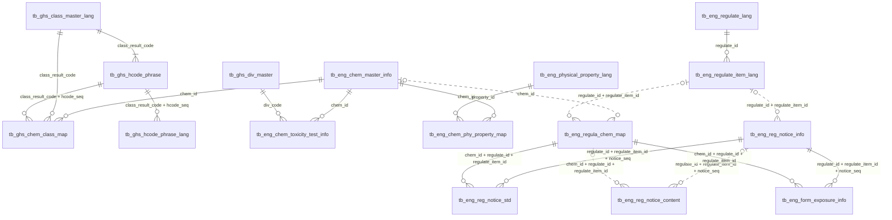
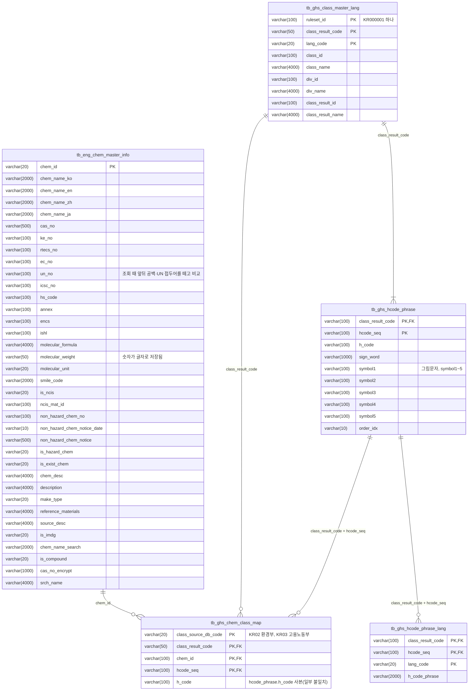
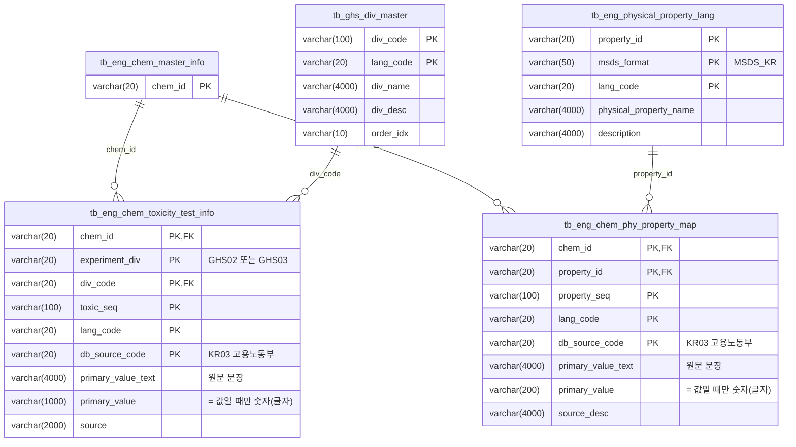
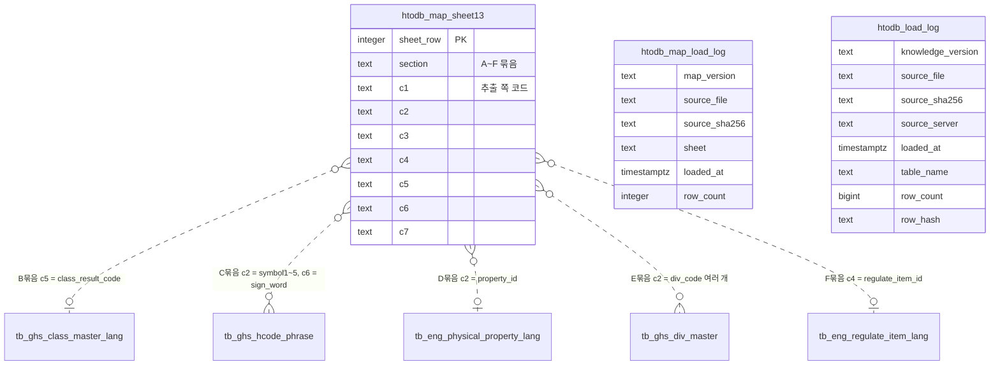

# TO21 지식DB(HTODB) ERD

로컬 PostgreSQL(`deploy/htodb/README.md`로 적재)에 들어 있는 두 스키마의 구조입니다.

- `htodb`: TO21이 준 HTODB 원본 16개 테이블과 적재 기록. 원본 SQL Server에서 이름만 소문자로 바꿔 그대로 옮겼습니다.
- `htodb_map`: 명세서 v0.6의 `13_TO21DB매핑` 시트(추출 코드 ↔ HTODB 코드 번역표)와 적재 기록.

조회 API가 이 테이블을 어떻게 읽는지는 [API.md](API.md)에 있습니다.

> 행 수와 코드 종류는 2026-11-01 로컬 적재본 기준이고, 다시 적재하면 바뀔 수 있습니다. 데이터 값은 적지 않습니다(D-47).

## 읽는 법

- **FK 제약이 없습니다.** 관계선과 `FK` 표시는 조회 코드(`repo.py`)가 쓰는 조인을 적은 논리 관계입니다.
  - 실선: 짝이 모두 맞는 관계입니다.
  - 점선: 짝 없는 행이 조금 있는 관계입니다. 건수는 맨 아래 관계 목록에 있습니다.
- **`_lang`·`_master` 기준정보 테이블:** PK에 `lang_code` 등이 들어 있지만 지금은 값이 하나뿐입니다(`ko`). 조인은 코드 컬럼만으로 합니다.
- **생략한 컬럼:** 모든 테이블에 반복되는 감사 컬럼(`is_del`/`del_yn`, `init_*`, `update_*`, `tran_src`)은 그림에서 뺐습니다.
- **타입:** 날짜와 숫자도 대부분 글자(`varchar`)입니다. NOT NULL은 PK 컬럼에만 있습니다.
- **도구:** Mermaid로 그렸습니다. GitHub와 PR에서 바로 그림으로 보이고, 외부 서비스에 구조를 올리지 않아도 됩니다. 복합 키는 선 이름에 `+`로 적었습니다.

## 전체 관계도

컬럼을 뺀 그림입니다. 스키마는 모두 `htodb`입니다. 번역표(`htodb_map`)와의 관계는 선이 겹쳐서 아래 ④에 따로 그렸습니다.



## 테이블 목록

| 묶음 | 테이블 | 내용 (기업 테이블설명 기준) | 행 수 | PK |
|---|---|---|---:|---|
| 물질 | `tb_eng_chem_master_info` | 물질 목록 | 670,699 | chem_id |
| GHS 분류 | `tb_ghs_chem_class_map` | 물질별 유해성 분류. `class_source_db_code` KR02 = 환경부, KR03 = 고용노동부 | 52,248 | class_source_db_code, class_result_code, chem_id, hcode_seq |
| | `tb_ghs_class_master_lang` | 기준정보: 유해성 분류 항목명 | 133 | ruleset_id, class_result_code, lang_code |
| | `tb_ghs_hcode_phrase` | 기준정보: 분류별 H코드·신호어·그림문자 | 136 | class_result_code, hcode_seq |
| | `tb_ghs_hcode_phrase_lang` | 기준정보: 분류별 H문구 | 133 | class_result_code, hcode_seq, lang_code |
| 독성 | `tb_eng_chem_toxicity_test_info` | 물질별 독성 정보. `db_source_code` KR03 = 고용노동부 | 143,187 | chem_id, experiment_div, div_code, toxic_seq, lang_code, db_source_code |
| | `tb_ghs_div_master` | 기준정보: 독성 정보 구분명 | 50 | div_code, lang_code |
| 물성 | `tb_eng_chem_phy_property_map` | 물질별 물성 정보. `db_source_code` KR03 = 고용노동부 | 147,131 | chem_id, property_id, property_seq, lang_code, db_source_code |
| | `tb_eng_physical_property_lang` | 기준정보: 물성 항목명 | 23 | property_id, msds_format, lang_code |
| 규제 | `tb_eng_regulate_lang` | 기준정보: 규제(법) 이름 | 5 | regulate_id, lang_code |
| | `tb_eng_regulate_item_lang` | 기준정보: 세부 규제 항목 이름 | 37 | regulate_id, regulate_item_id, lang_code |
| | `tb_eng_reg_notice_info` | 고시 정보 | 500 | regulate_id, regulate_item_id, notice_seq |
| | `tb_eng_regula_chem_map` | 규제 항목별 물질 목록 | 102,212 | chem_id, regulate_id, regulate_item_id |
| | `tb_eng_reg_notice_std` | 규제별 물질 함량 등 수치 | 54,067 | regulate_id, regulate_item_id, notice_seq, chem_id, std_seq |
| | `tb_eng_reg_notice_content` | 규제별 물질 세부 내용(글) | 56,036 | regulate_id, regulate_item_id, notice_seq, chem_id, lang_code |
| | `tb_eng_form_exposure_info` | 산안법 노출기준(MSDS 8항) | 4,149 | regulate_id, regulate_item_id, notice_seq, chem_id, exposure_form, exposure_limit_code, chem_group_id |
| 번역표 | `htodb_map.sheet13` | 명세서 `13_TO21DB매핑` 시트, 셀 값 그대로 | 246 | sheet_row |
| 기록 | `htodb.load_log` | 테이블마다 적재 행 수·값 해시, 원본 zip 해시 | 16 | 없음 |
| | `htodb_map.load_log` | 번역표 적재 기록, 명세서 xlsx 해시 | 1 | 없음 |

## 영역별 상세

### ① 물질 · GHS 분류

물질 하나(`chem_id`)에 분류 결과 여러 개가 붙습니다. 분류 결과 코드(`class_result_code`) 하나에 H코드가 1~2개(`hcode_seq`) 있고, H코드마다 신호어·그림문자(`hcode_phrase`)와 H문구(`hcode_phrase_lang`)가 있습니다.



- `tb_ghs_chem_class_map.h_code`는 `tb_ghs_hcode_phrase.h_code`와 같은 값을 한 번 더 적은 칸입니다. 그런데 23행은 두 값이 다릅니다. API는 두 값을 모두 그대로 돌려줍니다.
- H문구가 없는 H코드 행이 3개 있습니다(`hcode_phrase` 136행, `hcode_phrase_lang` 133행).

### ② 독성 · 물성



- 값은 대부분 `primary_value_text`(원문 문장)에 있습니다. `primary_value`는 '=' 값일 때만 채워져 있고, 그것도 글자입니다. API의 `parsed=true`가 문장에서 숫자를 뽑아 따로 붙입니다(API.md 참고).
- `experiment_div`는 대부분 `div_code`의 앞 다섯 글자와 같지만 다른 행도 있습니다(27행). 같다고 가정하고 조인하지 마세요.

### ③ 규제 · 노출기준

법(`regulate_id`) 아래 세부 항목(`regulate_item_id`)이 있고, 항목마다 고시(`notice_seq`)가 있습니다. 물질이 어떤 항목에 해당하는지는 `regula_chem_map`에 있고, 그 물질의 고시 수치·글·노출기준은 "고시 + 물질-항목 쌍"에 매달립니다.

```mermaid
erDiagram
    tb_eng_regulate_lang ||--o{ tb_eng_regulate_item_lang : "regulate_id"
    tb_eng_regulate_item_lang |o..o{ tb_eng_reg_notice_info : "regulate_id + regulate_item_id"
    tb_eng_chem_master_info |o..o{ tb_eng_regula_chem_map : "chem_id"
    tb_eng_regulate_item_lang |o..o{ tb_eng_regula_chem_map : "regulate_id + regulate_item_id"
    tb_eng_reg_notice_info ||--o{ tb_eng_reg_notice_std : "regulate_id + regulate_item_id + notice_seq"
    tb_eng_regula_chem_map ||--o{ tb_eng_reg_notice_std : "chem_id + regulate_id + regulate_item_id"
    tb_eng_reg_notice_info |o..o{ tb_eng_reg_notice_content : "regulate_id + regulate_item_id + notice_seq"
    tb_eng_regula_chem_map |o..o{ tb_eng_reg_notice_content : "chem_id + regulate_id + regulate_item_id"
    tb_eng_reg_notice_info ||--o{ tb_eng_form_exposure_info : "regulate_id + regulate_item_id + notice_seq"
    tb_eng_regula_chem_map ||--o{ tb_eng_form_exposure_info : "chem_id + regulate_id + regulate_item_id"
    tb_eng_chem_master_info {
        varchar(20) chem_id PK
    }
    tb_eng_regulate_lang {
        varchar(20) regulate_id PK
        varchar(20) lang_code PK
        varchar(4000) regulate_name
        varchar(4000) target_item
        varchar(4000) regulate_contents
    }
    tb_eng_regulate_item_lang {
        varchar(20) regulate_id PK, FK
        varchar(20) regulate_item_id PK
        varchar(20) lang_code PK
        varchar(4000) regulate_item_name
        varchar(4000) regulate_item_contents
    }
    tb_eng_reg_notice_info {
        varchar(20) regulate_id PK, FK
        varchar(20) regulate_item_id PK, FK
        varchar(20) notice_seq PK
        varchar(100) country_id
        varchar(100) organ_id
        varchar(500) notice_no
        varchar(14) notice_date
    }
    tb_eng_regula_chem_map {
        varchar(20) chem_id PK, FK
        varchar(20) regulate_id PK, FK
        varchar(20) regulate_item_id PK, FK
    }
    tb_eng_reg_notice_std {
        varchar(20) regulate_id PK, FK
        varchar(20) regulate_item_id PK, FK
        varchar(20) notice_seq PK, FK
        varchar(20) chem_id PK, FK
        varchar(100) std_seq PK
        varchar(1000) chem_state
        varchar(10) rch_last_app_date
        varchar(10) rch_sunset_date
        numeric(10,3) std_value_min
        numeric(10,3) std_value_max
        numeric(10,3) std_value_primary
        varchar(20) std_value_min_unit
        varchar(20) std_value_max_unit
        varchar(20) std_value_primary_unit
        varchar(20) std_value_min_sign
        varchar(20) std_value_max_sign
        varchar(20) std_value_primary_sign
        varchar(100) notice_class_no
        numeric(12,5) make_use_spec_qnty
        numeric(12,5) store_preserve_spec_qnty
        varchar(20) make_use_spec_qnty_unit
        varchar(20) store_preserve_spec_qnty_unit
        varchar(100) chem_group_id
        varchar(2000) chem_group_name
        varchar(20) research_range
        varchar(20) research_range_sign
        numeric(10,3) research_range_std
        varchar(20) research_range_unit
        varchar(20) research_weight
        varchar(20) research_weight_sign
        numeric(10,3) research_weight_std
        varchar(20) research_weight_unit
        varchar(1000) chem_state_2nd
        varchar(100) ppm_div
        varchar(100) ppmv
        numeric(10,3) minmax_diff
        varchar(20) minmax_diff_sign
        varchar(100) trade_max_exchange_kg
        varchar(100) trade_max_exchange_l
        varchar(20) designated_waste_hazard_chem1
        varchar(20) designated_waste_hazard_chem2
        varchar(20) designated_waste_hazard_chem3
    }
    tb_eng_reg_notice_content {
        varchar(20) regulate_id PK, FK
        varchar(20) regulate_item_id PK, FK
        varchar(20) notice_seq PK, FK
        varchar(20) chem_id PK, FK
        varchar(20) lang_code PK
        varchar(100) notice_unique_no
        varchar(4000) notice_contents
        varchar(4000) apply_basis
        varchar(4000) limit_item
        varchar(4000) prohibit_item
        varchar(4000) notice_desc
        varchar(200) group_id
        varchar(4000) source
        varchar(1000) measure_first
        varchar(1000) measure_cycle
        varchar(1000) chem_state
        varchar(4000) contents_kind
        varchar(4000) primary_used
        varchar(4000) substance_rate_std
        varchar(4000) used_std
    }
    tb_eng_form_exposure_info {
        varchar(20) regulate_id PK, FK
        varchar(20) regulate_item_id PK, FK
        varchar(20) notice_seq PK, FK
        varchar(20) chem_id PK, FK
        varchar(20) exposure_form PK
        varchar(20) exposure_limit_code PK
        varchar(100) chem_group_id PK
        varchar(400) exposure_limit_name
        varchar(500) chem_group_name
        varchar(500) exposure_form_detail
        varchar(500) chem_div_name
        varchar(200) exposure_ppm
        varchar(500) exposure_mg_m3
        varchar(200) exposure_ea_cm3
        varchar(2000) acgih_ppm
        varchar(2000) acgih_mg_m3
        varchar(4000) exposure_desc
        varchar(20) chem_div_no
        varchar(200) carcinogenicity
        varchar(200) reproduction_toxicity
        varchar(200) germ_cell_mutagenicity
        varchar(200) breast_feeding_toxic
        varchar(20) is_skin
        varchar(500) aspiration
        varchar(500) inhalation
        varchar(500) chest
    }
```

- `regulate_item_id`는 값만으로도 유일합니다. API 코드 사전도 `regulate_item_id` 하나로 찾습니다.
- 고시 500개 중 345개에는 물질별 수치(`reg_notice_std`) 행이 없습니다. 고시만 있고 수치는 없는 경우가 흔합니다.
- `std`·`content`·`exposure`의 `chem_id`는 `chem_master_info`와 직접 비교해도 됩니다(API는 `chem_id`로 바로 조회합니다). 짝 없는 행 수는 아래 관계 목록에 있습니다.

### ④ 번역표 · 적재 기록

`htodb_map.sheet13`은 시트 행을 셀 값 그대로 담고 있어서, 열 `c1`~`c7`의 뜻이 묶음(`section`)마다 다릅니다. 번역 코드(`backend/src/msds/compliance/htodb/mapping.py`의 `Map13`)는 아래처럼 읽습니다.

| 묶음 | 추출 JSON 쪽 | HTODB 쪽 | 연결되는 테이블 |
|---|---|---|---|
| A | 물질 키(CAS·KE·UN) 비교 규칙 | | 코드(`normalize_cas`, `normalize_un`)로 구현. 행은 번역에 쓰지 않음 |
| B | c1 `class_code`, c2 `category`, c3 `route_form`, c4 `effect` | c5 `class_result_code` | `tb_ghs_class_master_lang` |
| C | c1 그림문자 코드, c5 신호어 | c2 그림문자(`symbol1`~`symbol5` 값), c6 `sign_word` | `tb_ghs_hcode_phrase` |
| D | c1 `prop_code`(여러 개면 ` · `로 묶음) | c2 `property_id` | `tb_eng_physical_property_lang` |
| E | c1 독성·생태독성 `endpoint` | c2 `div_code`(여러 개, `/`로 줄여 씀) | `tb_ghs_div_master` |
| F | c1 규제 `item_code` | c4 `regulate_item_id` | `tb_eng_regulate_item_lang` |

- 시트에 나온 HTODB 코드는 모두 DB에 있습니다. 예외는 신호어 3개 중 1개입니다(`sign_word`에 없음).
- c1이 `(`로 시작하는 행은 자리표시라서 번역에서 뺍니다. 시트 행 자체는 DB에 남아 있습니다.
- `section`이 비어 있는 행 2개는 첫 묶음 제목보다 위에 있는 행입니다.



- `htodb.load_log`는 적재한 원본 테이블마다 한 행(16행)입니다. `knowledge_version`(`htodb-` + 원본 zip SHA-256 앞 12자리)은 모든 행이 같습니다.
- `htodb_map.load_log`의 `map_version`은 `map13-` + 명세서 xlsx SHA-256 앞 12자리입니다.
- 두 버전은 API 응답마다 함께 돌려줍니다. 어느 적재본으로 낸 결과인지 남길 때 씁니다.

## 관계 목록

데이터에서 확인한 짝 없는 자식 행 수입니다(2026-11-01 로컬 적재본).

| 자식 → 부모 | 조인 컬럼 | 짝 없는 행 |
|---|---|---:|
| `tb_ghs_chem_class_map` → `tb_eng_chem_master_info` | chem_id | 0 |
| `tb_ghs_chem_class_map` → `tb_ghs_class_master_lang` | class_result_code | 0 |
| `tb_ghs_chem_class_map` → `tb_ghs_hcode_phrase` | class_result_code, hcode_seq | 0 |
| `tb_ghs_hcode_phrase` → `tb_ghs_class_master_lang` | class_result_code | 0 |
| `tb_ghs_hcode_phrase_lang` → `tb_ghs_hcode_phrase` | class_result_code, hcode_seq | 0 |
| `tb_eng_chem_toxicity_test_info` → `tb_eng_chem_master_info` | chem_id | 0 |
| `tb_eng_chem_toxicity_test_info` → `tb_ghs_div_master` | div_code | 0 |
| `tb_eng_chem_phy_property_map` → `tb_eng_chem_master_info` | chem_id | 0 |
| `tb_eng_chem_phy_property_map` → `tb_eng_physical_property_lang` | property_id | 0 |
| `tb_eng_regulate_item_lang` → `tb_eng_regulate_lang` | regulate_id | 0 |
| `tb_eng_reg_notice_info` → `tb_eng_regulate_item_lang` | regulate_id, regulate_item_id | 6 |
| `tb_eng_regula_chem_map` → `tb_eng_chem_master_info` | chem_id | 4 |
| `tb_eng_regula_chem_map` → `tb_eng_regulate_item_lang` | regulate_id, regulate_item_id | 6 |
| `tb_eng_reg_notice_std` → `tb_eng_reg_notice_info` | regulate_id, regulate_item_id, notice_seq | 0 |
| `tb_eng_reg_notice_std` → `tb_eng_regula_chem_map` | chem_id, regulate_id, regulate_item_id | 0 |
| `tb_eng_reg_notice_std` → `tb_eng_chem_master_info` | chem_id | 4 |
| `tb_eng_reg_notice_content` → `tb_eng_reg_notice_info` | regulate_id, regulate_item_id, notice_seq | 1 |
| `tb_eng_reg_notice_content` → `tb_eng_regula_chem_map` | chem_id, regulate_id, regulate_item_id | 2 |
| `tb_eng_reg_notice_content` → `tb_eng_chem_master_info` | chem_id | 5 |
| `tb_eng_form_exposure_info` → `tb_eng_reg_notice_info` | regulate_id, regulate_item_id, notice_seq | 0 |
| `tb_eng_form_exposure_info` → `tb_eng_regula_chem_map` | chem_id, regulate_id, regulate_item_id | 0 |
| `tb_eng_form_exposure_info` → `tb_eng_chem_master_info` | chem_id | 0 |
